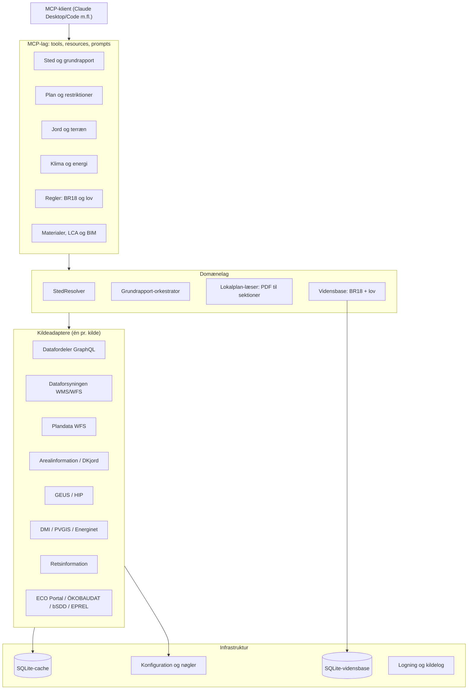

# Arkitektur: MCP for bygningsdesign i Danmark

*Udkast 1, 7. november 2026. Bygger på [filtrering.md](../01-screening/filtrering.md) (39 MVP-kilder i 9 værktøjsgrupper).*

## 1. Mål og principper

**Mål:** En sprogmodel (Claude eller andre MCP-klienter) skal kunne besvare en bygningsdesigners spørgsmål om et konkret sted og et konkret krav. Svarene skal være korrekte, have kildeangivelse og være til at efterprøve.

**Principper:**
1. **Stedet er omdrejningspunktet.** Næsten alle spørgsmål starter med en adresse eller en matrikel. Ét centralt opslag oversætter den til alle de nøgler, de andre kilder bruger.
2. **Få, stærke værktøjer frem for mange små.** Modeller vælger dårligere, når de har 80 værktøjer. Målet er 15–20 værktøjer i MVP, grupperet efter de spørgsmål, praksis stiller.
3. **Altid kilde og tidspunkt.** Hvert svar har datakilde, hentetidspunkt, link og eventuel gyldighedsdato (fx BR18-version).
4. **Data, ikke afgørelser.** MCP'en leverer grundlaget og citerer reglerne. Den træffer ikke myndighedsafgørelser og skal tydeligt markere, hvornår noget kræver faglig eller myndighedsmæssig vurdering.
5. **Delvise svar frem for fejl.** Fejler én kilde i en samlet rapport, returneres resten med en tydelig note.
6. **Udskiftelige kildeadaptere.** Kilder lukker og ombygges (DAWA, FBB, Datafordeler-REST). Hver kilde ligger bag sit eget modul, så den kan skiftes ud uden at ændre værktøjerne.

## 2. Teknologivalg

| Valg | Anbefaling | Begrundelse |
|---|---|---|
| Sprog | **Python 3.12+** | Stærkt geo-økosystem (shapely, pyproj), PDF-udtræk (PyMuPDF) og IFC (IfcOpenShell). Nemt at vedligeholde i et forsknings- og undervisningsmiljø |
| MCP-ramme | **Officielt MCP Python SDK (FastMCP)** | Tools, resources og prompts med typede skemaer |
| HTTP | httpx (async) | Parallelle kald i grundrapporten |
| GraphQL | gql eller rå httpx-POST | Datafordelerens nye tjenester |
| Cache og vidensbase | **SQLite** (inkl. FTS5 fuldtekst) | Én fil, ingen server, fuldtekstsøgning i BR18 |
| Geodata | shapely, pyproj, OWSLib (WFS/WMS) | Plandata, Arealinformation, GEUS |
| Transport | stdio (lokalt) → streamable HTTP (senere hosting) | Start i Claude Desktop/Code, del senere med kolleger og studerende |
| Pakkehåndtering | uv + pyproject.toml | Hurtig og reproducerbar |

## 3. Lagdeling



**Kildeadapter:** én klasse pr. kilde med fælles interface: hent, timeout, retry, rate limit, cache-TTL og en `Kildeangivelse` (navn, URL, licens, hentetidspunkt). Adapterne kender intet til MCP.

**Domænelag:** forretningslogikken. Den kombinerer adaptere, oversætter mellem ID-systemer og formaterer resultater.

**MCP-lag:** tynde wrappers, der eksponerer domænefunktionerne som tools, resources og prompts med danske beskrivelser.

## 4. Det centrale objekt: `Sted`

Danske grunddata bruger mange forskellige nøgler. `StedResolver` tager én af dem og returnerer alle:

| Felt | Eksempel | Bruges af |
|---|---|---|
| `adresse` (tekst + DAR-UUID) | "Sofiendalsvej 60, 9200 Aalborg SV" | Brugerinput, DAR |
| `husnummer_id` | UUID | DAR, BBR |
| `bfe_nummer` | 12345678 | EBR, VUR, Tinglysning, BBR |
| `jordstykker` (ejerlavskode + matrikelnr + geometri) | 551051 / 12a | MAT, areal, skel |
| `kommune` (kode + navn) | 0851 Aalborg | Plandata, myndighed |
| `punkt` (EPSG:25832 + WGS84) | (553000, 6320000) | Alle kortkilder, DMI, PVGIS |
| `grundgeometri` | Polygon | Intersect med planer og restriktioner |
| `bygninger` (BBR-ID'er) | [UUID, ...] | BBR |

Input kan være adresse (fritekst), matrikel, BFE-nummer eller koordinat. `Sted` caches, så de efterfølgende værktøjer i samme samtale ikke slår op igen.

## 5. Værktøjer i MVP (forslag: 18 tools)

Alle navne er på dansk med præfiks efter gruppe. Alle returnerer struktureret JSON med `kilder[]`.

### Sted og grundrapport
| Tool | Input | Output |
|---|---|---|
| `sted_find` | adresse / matrikel / BFE / koordinat | `Sted` med alle nøgler. Ved tvetydighed: kandidatliste |
| `grundrapport` | sted, evt. udvalgte emner | Samlet rapport: ejendom, bygninger, plan, restriktioner, jord, terræn. Kører kilderne parallelt |

### Bygning
| Tool | Input | Output |
|---|---|---|
| `bygning_bbr` | sted | Bygninger og enheder: anvendelse, år, arealer, etager, materialer, varmeforsyning |

### Plan og restriktioner
| Tool | Input | Output |
|---|---|---|
| `plan_gaeldende` | sted | Lokalplaner, delområder, kommuneplanramme, zonestatus, link til PDF |
| `plan_laes_lokalplan` | plan-ID, evt. emne ("højde", "parkering") | Udtrukne sektioner fra lokalplan-PDF med §-henvisninger |
| `restriktioner` | sted | Beskyttelseslinjer, Natura 2000, § 3-natur, fredninger, OSD, kystnærhed, støj |

### Jord og terræn
| Tool | Input | Output |
|---|---|---|
| `jord_forurening` | sted | V1/V2-kortlægning, områdeklassificering |
| `jord_geologi` | sted, radius | Nærmeste boringer med lagfølge, jordartskort, terrænnært grundvand |
| `terraen` | sted / punkter | Terrænkoter, højdeforskel på grunden, nabobygningers højder |
| `kort_udsnit` | sted, lag (ortofoto, skråfoto, historisk, skærmkort) | Billed-URL eller billede til visuel kontekst |

### Klima og energi
| Tool | Input | Output |
|---|---|---|
| `klima_data` | sted, type (nedbør, vind, temperatur, fremskrivning) | DMI-observationer og Klimaatlas |
| `sol_og_pv` | sted, hældning, orientering | PVGIS: indstråling og PV-ydelse |
| `vejrfil` | sted | Nærmeste EPW-fil (link) |
| `el_co2` | periode | Energinets CO2-intensitet for el |

### Regler
| Tool | Input | Output |
|---|---|---|
| `br18_soeg` | fritekst eller emne | Relevante §§ med tekst, vejledningsuddrag og link. Angiver versionsdato |
| `br18_paragraf` | §-nummer | Fuld ordlyd plus tilhørende vejledning |
| `lov_soeg` | fritekst / ELI | Love og bekendtgørelser fra Retsinformation |

### Materialer, LCA og BIM
| Tool | Input | Output |
|---|---|---|
| `lca_materiale` | materiale eller produkt | EPD'er og generiske data (ECO Portal, ÖKOBAUDAT, BR18 tabel 7) med GWP pr. modul |
| `bim_klassifikation` | begreb eller IFC-klasse | bSDD-opslag inkl. CCI-klassifikation og egenskaber |

*(EPREL-produktopslag kan lægges ind under `lca_materiale` eller som eget værktøj, når energimodulet udvides.)*

## 6. Resources og prompts

**Resources** (data klienten kan læse direkte):
- `br18://kapitel/{nr}` og `br18://paragraf/{nr}`: BR18 som strukturerede dokumenter
- `br18://klimakrav`: aktuelle grænseværdier (2025/2027/2029)
- `katalog://kilder`: kildekataloget med status, så modellen kan forklare, hvad den ved og ikke ved

**Prompts** (færdige arbejdsgange, brugeren kan vælge):
- `grundscreening`: tidlig fase. Sted → grundrapport → vurdering af byggemuligheder
- `br18_tjek`: gennemgå et projekt (beskrivelse eller tal) mod relevante BR18-krav
- `renovering_forundersoegelse`: BBR, bevaring, energimærke (når tilgængeligt), historiske kort, miljø
- `lca_tidlig_fase`: materialevalg og estimat mod grænseværdien

## 7. Vidensbase for BR18 og vejledninger

BR18 har ingen API og er samtidig den vigtigste kilde. Derfor bygges en lokal vidensbase:

1. **Indsamling:** et script henter bygningsreglementet.dk og BEK-versionen fra Retsinformation (XML). Retsinformation er den juridisk gældende tekst. Bygningsreglementet.dk har vejledningerne.
2. **Strukturering:** opdeling efter kapitel → § → stk., med vejledningstekst koblet til den paragraf, den uddyber.
3. **Versionering:** hver indsamling får en dato. Ændringer mellem versioner logges, så svar kan sige "gældende fra 1. juli 2025".
4. **Søgning:** SQLite FTS5 i første omgang (enkelt, hurtigt, ingen eksterne afhængigheder). Semantisk søgning med embeddings kan tilføjes, hvis FTS ikke er godt nok.
5. **Opdatering:** ugentlig kørsel, der advarer, hvis teksten har ændret sig.

**Lokalplaner** håndteres anderledes: de hentes efter behov (PDF fra Plandata), teksten udtrækkes med PyMuPDF og opdeles i §§. Sprogmodellen fortolker selv indholdet. MCP'en leverer den relevante tekst med §-henvisning og link til den originale PDF.

## 8. Cache og ydeevne

| Datatype | TTL | Begrundelse |
|---|---|---|
| Sted-opslag (adresse → nøgler) | 30 dage | Ændres sjældent |
| BBR, matrikel | 1 dag | Opdateres løbende |
| Plandata, restriktioner | 7 dage | Planer vedtages sjældent |
| GEUS, geologi, historiske kort | 90 dage | Næsten statisk |
| DMI-observationer | 1 time | Løbende data |
| BR18-vidensbase | Versionsstyret | Kun ved ny indsamling |
| Lokalplan-PDF'er | 30 dage (pr. plan-ID og version) | Store filer |

Grundrapporten kører alle kilder parallelt (asyncio) med en timeout pr. kilde. Målet er svar på under 10 sekunder.

## 9. Konfiguration, adgang og licens

- **Nøgler** i miljøvariabler eller en lokal `.env`, som aldrig committes: Datafordeler-adgang, Dataforsyningen-token og EPREL-nøgle. DMI, Retsinformation, PVGIS, Plandata og Arealinformation kræver ingen nøgle.
- **Licens:** danske grunddata er frie, men kræver kildeangivelse, fx "Indeholder data fra Klimadatastyrelsen". Hvert svar har kildeangivelse, og et samlet licensoverblik ligger i `katalog://kilder`.
- **Persondata:** ejeroplysninger (EJF) holdes ude af MVP. Hvis de senere tilføjes, kræver det adgangsstyring og en GDPR-vurdering.
- **Fair use:** rate limits respekteres pr. adapter (fx Retsinformation 1 kald/10 sek og kun kl. 03–23:45).

## 10. Mappestruktur

```
ultimate-mcp-byg/
├── pyproject.toml
├── src/byg_mcp/
│   ├── server.py              # MCP-server: registrerer tools/resources/prompts
│   ├── tools/                 # tynde MCP-wrappers pr. gruppe
│   │   ├── sted.py  plan.py  jord.py  klima.py  regler.py  materialer.py
│   ├── domain/
│   │   ├── sted.py            # Sted-model og StedResolver
│   │   ├── grundrapport.py
│   │   ├── lokalplan.py       # PDF-udtræk
│   │   └── vidensbase.py      # BR18-søgning
│   ├── adapters/              # én fil pr. kilde
│   │   ├── base.py            # fælles interface, cache, retry, Kildeangivelse
│   │   ├── datafordeler.py  dataforsyningen.py  plandata.py
│   │   ├── arealinfo.py  dkjord.py  geus.py  hip.py
│   │   ├── dmi.py  pvgis.py  energinet.py
│   │   ├── retsinformation.py  bygningsreglementet.py
│   │   └── ecoportal.py  oekobaudat.py  bsdd.py  eprel.py
│   └── infra/  cache.py  config.py  logging.py
├── scripts/
│   ├── indsaml_br18.py        # bygger vidensbasen
│   └── filtrer.py             # (findes) kildefiltrering
├── data/                      # SQLite-filer (gitignored)
└── tests/
    ├── fixtures/              # optagne svar fra kilderne
    └── testadresser.yaml      # kendte adresser med forventede resultater
```

## 11. Test og kvalitet

- **Testadresser:** 10–15 udvalgte adresser, der dækker byzone/landzone/sommerhuszone, kystnært, forurenet grund, fredet bygning og lokalplan/ingen lokalplan. Forventede resultater skrives ned manuelt.
- **Optagede svar** (fixtures) gør, at testene kan køre uden net og uden at belaste kilderne.
- **Kontraktest** mod de rigtige kilder én gang ugentligt. De fanger, når en kilde ændrer format eller lukker.
- **Evaluering af svar:** et sæt realistiske spørgsmål fra arkitekter, ingeniører og konstruktører, hvor svarene vurderes fagligt. Det er også et oplagt studenter- eller forskningsprojekt.

## 12. Milepæle

| Milepæl | Indhold | Afklarer |
|---|---|---|
| **M0 Spike** | Projektskelet, MCP-server med ét dummy-tool, kald til Datafordeler GraphQL, Plandata WFS og Arealinformation | Auth-model på den moderniserede Datafordeler, lagnavne i Plandata, nøglekrav |
| **M1 Sted** | `sted_find`, `bygning_bbr`, cache, kildeangivelse | ID-kæden adresse → BFE → matrikel → BBR |
| **M2 Plan** | `plan_gaeldende`, `restriktioner`, `plan_laes_lokalplan` | Kvaliteten af PDF-udtræk fra lokalplaner |
| **M3 Grundrapport** | `jord_*`, `terraen`, `kort_udsnit`, `grundrapport` + prompten `grundscreening` | **Første brugbare version for praktikere** |
| **M4 Regler** | BR18-vidensbase, `br18_*`, `lov_soeg`, resources | Strukturering af BR18 og vejledninger |
| **M5 Klima, LCA og BIM** | `klima_data`, `sol_og_pv`, `vejrfil`, `el_co2`, `lca_materiale`, `bim_klassifikation` | Dækning af danske EPD'er i ECO Portal |
| **M6 Fase 2-kilder** | Tinglysning, energimærker, bevaringsværdige bygninger (efter FBB), nævnsafgørelser | Aftaler og adgang |

## 13. Åbne spørgsmål

1. **Hvem er brugerne i første omgang?** Dig selv, kolleger på UCN, studerende eller rådgivende virksomheder? Det afgør, om lokal stdio er nok, eller om der skal hostes.
2. **Licenser:** Har UCN adgang til BUILD-anvisninger, Dansk Standard eller Molio, som kan bruges i en intern version?
3. **Open source?** Skal projektet ligge offentligt på GitHub? Det taler for at holde kommercielle kilder helt ude af kodebasen.
4. **Sprog:** Er dansk tool-navngivning det rigtige, eller skal det være engelsk for at kunne bruges internationalt?
